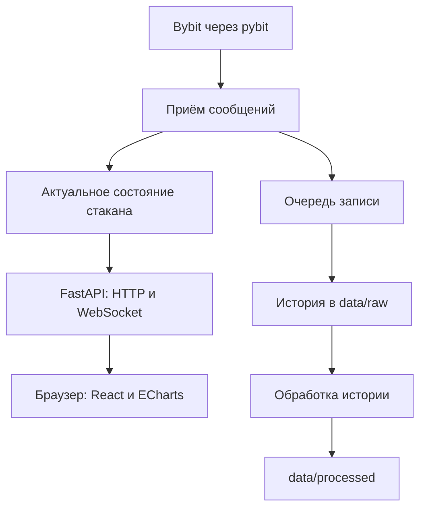

# Архитектура Finmarket-Lab

## Назначение

Finmarket-Lab — лаборатория для получения, хранения и исследования рыночных данных. Первая задача — работа с торговым стаканом Bybit: получение данных, сохранение истории и отображение текущего состояния.

В дальнейшем проект может включать анализ OHLC, тестирование торговых стратегий, ML-модели и инвестиционные отчёты. Эти возможности не входят в первую версию веб-интерфейса.

## Текущее состояние и планы

| Часть | Состояние по описанию проекта |
| --- | --- |
| Получение стакана через Python и pybit | Уже использовалось |
| Сохранение входящих сообщений | Уже использовалось; актуальный формат требует проверки |
| Визуализация через matplotlib | Есть прототип |
| Очереди для записи и отображения | Обсуждались; реализацию нужно сверить с кодом |
| React + TypeScript + ECharts | Выбранный стек будущего веб-интерфейса |
| Vite | Предлагаемый инструмент разработки и сборки фронтенда |
| FastAPI и передача стакана в браузер | Планируемая интеграция; наличие готового API не подтверждено |

После сверки с репозиторием эту таблицу следует обновить. Названия модулей, маршруты и форматы ниже описывают целевую схему, а не гарантированно существующий код.

## Компоненты и ответственность

| Компонент | Ответственность |
| --- | --- |
| Источник данных: Bybit / pybit | Подписка на поток биржи и получение сообщений |
| Обработка стакана на Python | Проверка входа, поддержание актуального состояния, подготовка данных для клиентов |
| Запись данных | Сохранение истории независимо от скорости отображения |
| FastAPI | HTTP API и WebSocket для доступа к данным Python-приложения |
| Uvicorn | Запуск FastAPI-приложения и обслуживание сетевых соединений |
| React | Компоненты интерфейса и отображение их состояния |
| TypeScript | Описание типов фронтенда и проверка кода до запуска |
| ECharts | Построение графиков в браузере |
| Vite | Подготовка фронтенда во время разработки и сборка файлов для публикации |

FastAPI предоставляет доступ к Python-логике. Получение данных биржи, обработку стакана и запись файлов стоит держать в отдельных модулях, чтобы их можно было использовать без веб-интерфейса.

## Целевой поток данных

Живой интерфейс получает данные из текущего состояния в памяти. Ему не требуется постоянно открывать файл и читать последнюю строку. Файлы нужны для истории, повторного воспроизведения и исследований.

### Получение и обработка

Обработчик входящего сообщения должен выполнять короткую работу: передать данные дальнейшим обработчикам. Медленная запись и отрисовка не должны надолго задерживать приём.

На уровне протокола Bybit различаются полный снимок (`snapshot`) и изменения (`delta`). Снимок задаёт состояние целиком; изменения применяются к уже имеющемуся состоянию. При новом снимке предыдущее состояние заменяется.

Перед реализацией нужно проверить, что именно передаёт callback установленной версии pybit: исходное сообщение биржи или уже собранный SDK стакан. Нельзя повторно применять изменения или считать неполный набор уровней полным стаканом. Сохранять следует независимое представление сообщения: если SDK переиспользует изменяемые объекты, нужна копия или сериализация на границе приёма.

### Очереди и актуальность

Очередь — буфер между получателем данных и обработчиком. Одна общая очередь с двумя читателями распределяет сообщения между ними. Если и запись, и визуализация должны получить данные, необходима явная передача в оба направления.

Для отображения допустимо сохранять только последний **полный подготовленный снимок**: браузеру обычно не требуется рисовать каждое промежуточное состояние. Пропускать необработанные изменения стакана нельзя: это может нарушить его состояние.

Для записи истории нужна отдельная политика переполнения очереди. Неограниченный буфер может исчерпать память, а молчаливое удаление сообщений делает историю неполной. В первой реализации следует выбрать ограничение, логировать перегрузку и явно отмечать разрывы данных.

При соединении потоков pybit с асинхронным приложением FastAPI нужно предусмотреть безопасную передачу между потоками. Асинхронная очередь сама по себе не является потокобезопасной.

## Хранение данных

| Каталог | Назначение |
| --- | --- |
| `data/raw/` | Сообщения, сохранённые на границе получения |
| `data/processed/` | Результаты преобразования истории для анализа |

Для первых записей предлагается JSONL: один самостоятельный JSON-объект на строку. Если pybit преобразует данные до callback, содержимое `raw` следует описывать как «данные callback», а не как неизменённый поток биржи.

Полезно сохранять источник, инструмент, время биржи и время получения. Большие наборы рыночных данных не следует добавлять в Git; в репозитории можно оставить небольшой пример для разработки.

## Контракт backend и frontend

Контракт — согласованный формат запросов и ответов. Для первого этапа предлагаются:

| Интерфейс | Назначение | Статус |
| --- | --- | --- |
| `GET /api/health` | Проверить доступность API | Предложение |
| `GET /api/orderbook?symbol=BTCUSDT` | Получить текущий полный снимок | Предложение |
| `/ws/orderbook?symbol=BTCUSDT` | Получать полные подготовленные снимки по WebSocket | Предложение |

Формат снимка должен явно задавать инструмент, время, уровни `bids` и `asks`. Для каждого уровня нужны цена и объём; единицы объёма зависят от рынка и должны быть документированы. Сторона backend сортирует покупки по убыванию цены, продажи по возрастанию.

Точные цены и объёмы можно передавать десятичными строками. Преобразование в JavaScript `number` допустимо для графика, но не должно становиться основой точных денежных расчётов. Типы TypeScript не проверяют полученный JSON во время выполнения: данные всё равно требуют проверки.

Интерфейс должен различать загрузку, актуальные данные, устаревшие данные и отключение. После разрыва соединения следует получить новый полный снимок. Конкретные интервалы обновления и повторного подключения пока не выбраны.

## Разработка и публикация

При локальной разработке работают Vite и Uvicorn с FastAPI. Vite отдаёт фронтенд, а FastAPI предоставляет данные. Запросы браузера можно направить через прокси Vite.

После сборки фронтенд представляет собой HTML, CSS и JavaScript. Их может обслуживать веб-сервер или статический хостинг; Python-backend продолжает работать отдельно. Конкретный способ размещения пока не выбран.

Для первой версии достаточно одного процесса backend с одним источником данных. Запуск нескольких Uvicorn workers требует отдельного решения для общего состояния: память процессов не общая, а подписка на биржу может создаваться в каждом процессе.

## Предлагаемое размещение кода

Это ориентир для постепенного развития, а не инструкция создавать все каталоги сразу.

| Путь | Содержимое |
| --- | --- |
| `src/finmarket_lab/market_data/` | Подключение к источникам данных |
| `src/finmarket_lab/orderbook/` | Состояние и преобразования стакана |
| `src/finmarket_lab/storage/` | Запись и чтение истории |
| `src/finmarket_lab/api/` | FastAPI-приложение и маршруты |
| `frontend/` | React-приложение и его зависимости |
| `docs/` | Документация |
| `tests/` | Проверки обработки данных и других критичных частей |

Первый сквозной этап: показать в React фиксированный стакан, затем получить его через HTTP, после этого подключить WebSocket и реальные данные. Торговые операции в этот этап не входят.

## Связанные материалы

- [Фронтенд: инструменты и взаимодействие с backend](frontend.md)
- [Bybit: протокол стакана](https://bybit-exchange.github.io/docs/v5/websocket/public/orderbook)
- [FastAPI](https://fastapi.tiangolo.com/)
- [WebSocket в FastAPI](https://fastapi.tiangolo.com/advanced/websockets/)

